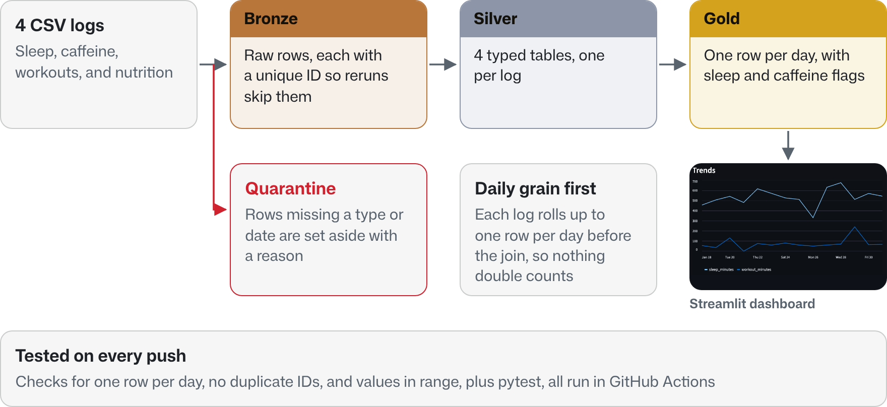

[](https://github.com/jeffreylin0217/sleeplift/actions/workflows/ci.yml)

# SleepLift

SleepLift is a batch ELT analytics pipeline for sleep, caffeine, workout, and nutrition logs. It loads CSV exports into DuckDB, organizes records into Bronze, Silver, and Gold layers, validates the outputs, and produces a `daily_features` table for a Streamlit dashboard.

The project is intentionally local in scope rather than a production health application. It focuses on data ingestion, data modeling, data-quality validation, automated testing, and dashboard-ready analytics on a small reproducible dataset.

## What the project does

<picture>
  <source media="(prefers-color-scheme: dark)" srcset="docs/images/sleeplift-architecture-dark.png">
  
</picture>

## Key features

- Ingests 4 CSV event streams: `sleep.csv`, `caffeine.csv`, `workout.csv`, and `nutrition.csv`
- Stores raw records in DuckDB with deterministic SHA-256 `event_id` values to avoid duplicate inserts on reruns
- Builds typed Silver tables for sleep, caffeine, workout, and nutrition records
- Builds a Gold `daily_features` table with one row per day for dashboarding and analysis
- Runs data-quality checks for duplicate records, invalid values, and malformed rows
- Sends malformed records to `dead_rows` instead of mixing them into clean analytics tables
- Includes pytest checks for Gold-layer invariants and malformed-input quarantine behavior, executed through GitHub Actions CI

## Design decisions

- **Deterministic event IDs.** Each raw row gets a SHA-256 `event_id` built from its normalized contents, and Bronze inserts use `ON CONFLICT(event_id) DO NOTHING`, so rerunning on the same files adds no duplicate rows.
- **Quarantine instead of failing the run.** Files with unsupported columns and rows missing a type or date go to `dead_rows` with a reason, so one bad export does not stop the pipeline or leak into clean tables.
- **Aggregate before joining.** Each domain is rolled up to one row per day before the Gold join. Joining event level tables directly on date multiplies rows (two caffeine entries and two workouts on the same day become four rows) and inflates daily totals.
- **Date spine.** `daily_features` starts from every day that appears in any domain and left joins the daily rollups, so a day with only a workout logged still shows up.
- **ELT, not ETL.** Raw rows land in Bronze as text in one shared shape and are typed in SQL afterward, so the original values can always be reprocessed.

## Quick start

```bash
python3 -m venv .venv
source .venv/bin/activate
pip install -r requirements.txt
pip install -r requirements-dev.txt

# optional: copy demo inputs into the raw input folder
cp data/raw/sample/*.csv data/raw/

python3 src/pipeline/run_all.py
pytest -q
streamlit run src/dashboard.py
```

## Input format

The demo data uses one simple CSV per log type:

```text
data/raw/sleep.csv
data/raw/caffeine.csv
data/raw/workout.csv
data/raw/nutrition.csv
```

The pipeline also supports the older unified export format used during early development:

```text
./data/raw/demo_events.csv
```

Do not commit real personal health data. Use the fake sample files in `data/raw/sample/` for demos, CI, and sharing.

## Main tables

- `raw_events`: Bronze table with one row per raw event and a deterministic `event_id`
- `dead_rows`: malformed rows that should not enter the clean tables
- `sleep`, `caffeine`, `workout`, `nutrition`: typed Silver tables
- `daily_features`: Gold feature mart with one row per day and 15 fields, including low sleep, late caffeine, and high caffeine flags

## Screenshots

### Dashboard


### Gold table preview


### Pipeline run


### CI passing


## Repository layout

```text
src/pipeline/ingest.py       # load CSVs into raw_events
src/pipeline/transform.py    # build typed Silver tables
src/pipeline/build_gold.py   # build daily_features and export CSV
src/pipeline/quality.py      # validate core outputs
tests/test_gold_invariants.py
tests/test_quarantine.py
src/dashboard.py
docs/data_dictionary.md
docs/sql_examples.md
```
